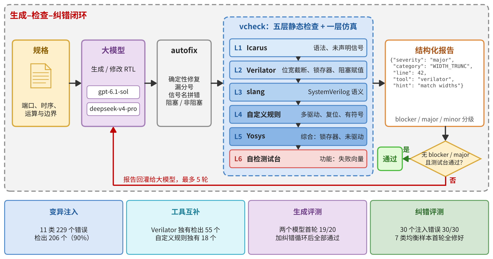
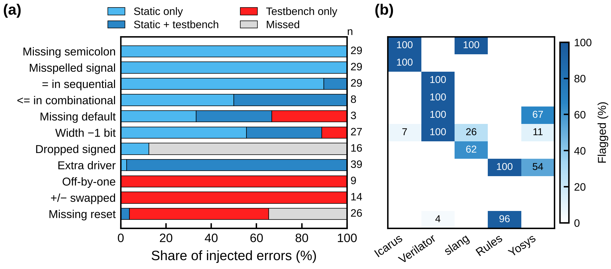
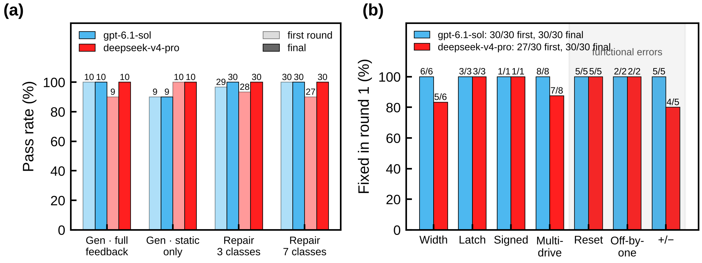

# verilog-gen-check

🌐 **简体中文** | [English](README_EN.md)

**大模型 Verilog 自动生成与五层静态纠错 skill** · LLM-driven Verilog generation with a five-layer static checker and closed-loop repair

[](https://github.com/djawhda/verilog-gen-check/actions/workflows/ci.yml)

本仓库是"忆阻器 Booth 模拟乘法器的 AI 全流程设计"作品中的 RTL 模块。它把"按规格写 RTL → 检查 → 按报告修改"做成一个可供智能体（Claude Code、Codex 等）直接调用的 skill，检查链全部基于开源工具，每一轮生成、报告和修改都留档，可以复现和审计。



## 为什么需要它

- 大模型写 Verilog 很快，但位宽截断、锁存器、多驱动、有符号混用这类错误在功能仿真里常常照样通过；复位遗漏、边界差 1、运算符写反又是静态工具查不出的。单靠一种检查一定会漏掉另一类。
- 商用 lint/综合工具授权昂贵且受出口管制影响；本仓库只用 Icarus Verilog、Verilator、slang、Yosys 四个开源工具加自定义规则，任何一台 Linux / Windows 机器都能跑。
- 报告是结构化的（类别、严重程度、源码行、修复提示），可以直接回灌给大模型，形成闭环。

## 五层检查 + 一层仿真

| 层 | 工具 | 主要检查内容 |
|---|---|---|
| L1 syntax | `iverilog -g2012` | 语法、未声明信号、模块与端口绑定 |
| L2 lint | `verilator --lint-only -Wall` | 阻塞/非阻塞用反、锁存器、位宽截断与扩展、组合环路、未驱动 |
| L3 semantic | `slang -Weverything`（pyslang） | 有符号/无符号混算、符号转换、case 缺 default |
| L4 rules | `tools/rules.py` | 多处驱动（区分 generate if/else 互斥分支）、寄存器漏复位 |
| L5 synth | `yosys proc; check` | 综合推断出的锁存器、多驱动冲突、逻辑环路 |
| sim | `iverilog + vvp` | 自检测试台，输出 `TB_PASS` / `TB_FAIL` 与失败向量 |

问题分 blocker / major / minor / info 四级。几个工具在同一行报同一类问题时自动合并并记录由哪些工具确认；行尾写 `// vcheck-waive: 类别 原因` 可豁免一条问题，报告单列全部豁免。机械性错误（漏分号、信号名拼错、阻塞/非阻塞用反）先由 `tools/autofix.py` 确定性修复，减少模型调用次数。

## 快速开始

```bash
# 1. 安装工具（Ubuntu 24.04；Windows 可用 OSS CAD Suite）
sudo apt install iverilog verilator yosys   # Ubuntu 24.04：Icarus 12.0、Verilator 5.020、Yosys 0.33
pip install "pyslang==12.1.0"      # 与 CI 相同版本

# 2. 自检：10 道题的标准答案应全部通过
python3 tools/benchlib.py

# 3. 检查你自己的设计
python3 tools/vcheck.py my.v --top my_top --tb tb_my_top.sv --log-dir runs/my_top
python3 tools/autofix.py my.v --top my_top --tb tb_my_top.sv      # 可选：先做确定性修复
```

### 作为智能体 skill 使用

- **Claude Code**：把整个仓库放到 `~/.claude/skills/verilog-gen-check/`（个人）或项目内 `.claude/skills/verilog-gen-check/`，智能体会按 `SKILL.md` 的流程工作。
- **Codex 等其他智能体**：在 `AGENTS.md` 或提示词中引用 `SKILL.md`，并允许它运行 `tools/vcheck.py`。

### 大模型闭环评测

`tools/llm_loop.py` 支持 OpenAI 兼容接口（DeepSeek、通义、本地 vLLM）、Anthropic 接口、任意命令行（如 `codex exec`）和回放四种后端：

```bash
export DEEPSEEK_API_KEY=...
# 生成：只给规格，最多 5 轮
python3 tools/llm_loop.py --mode gen --backend openai --base-url https://api.deepseek.com/v1 \
    --model deepseek-v4-pro --api-key-env DEEPSEEK_API_KEY --rounds 5 --out results/gen_deepseek
# 纠错：7 类错误按类别均衡抽 30 个变异体，先跑 autofix，剩下的交给模型
python3 tools/llm_loop.py --mode repair --mutants results/mutation/mutants --autofix-first \
    --ops width latch signed multidrive reset offbyone operator --per-task 3 --feedback full \
    --backend openai --base-url https://api.deepseek.com/v1 --model deepseek-v4-pro \
    --api-key-env DEEPSEEK_API_KEY --temperature 0.2 --rounds 5 --out results/repair_balanced_deepseek
python3 tools/repair_by_category.py results/repair_balanced_deepseek/summary.json \
    results/llm_eval_two_models/selection_balanced.json results/repair_balanced_deepseek/按类别.md
```

每道题每一轮保存 `prompt.md`、`response.md`、代码、`report.json/md`，汇总在 `summary.md`。

## 题库

10 道题取自实际 FPGA 工程，每题含 `spec.md` 规格、标准答案、自检测试台和 `meta.json`：

| 题目 | 考点 |
|---|---|
| `booth_encoder` | radix-4 Booth 编码、独热选通 |
| `booth_mul4` | Booth 算法、符号扩展、禁用 `*` 运算符（256 组穷举） |
| `weighted_sum` | 定点舍入、流水线延迟 |
| `dac_map` | 48 位有符号定点、负增益、钳位 |
| `lin_lookup` | ROM 初始化（asinh→线性查找表）、地址偏移 |
| `replay_addr` | 分频计数、换槽位重启、同步脉冲 |
| `sync_fifo` / `uart_tx` / `pwm` / `debounce` | 满空判断、逐周期时序、同步与消抖 |

## 评测结果

**错误注入（无需大模型）。** 在 10 个标准答案中注入 11 类共 229 个错误，检查链加测试台检出 206 个（90%）：静态层检出 163 个，43 个只能由测试台发现；55 个错误只有 Verilator 能查出，18 个只有自定义规则能查出。



**两个大模型。** 同一套测试台、完整五层工具链重查：

| | gpt-6.1-sol（Codex） | deepseek-v4-pro（API） |
|---|---|---|
| 生成：首轮通过（两组合计） | 19/20 | 19/20 |
| 生成：完整反馈下最终通过 | 10/10 | 10/10 |
| 纠错：30 个 7 类均衡样本，第 1 轮修好 | 30/30 | 27/30 |
| 纠错：最终修好 | 30/30 | 30/30 |



原始台账、逐题记录和复核报告见 `results/`。

## 目录

```
SKILL.md                智能体工作流程
tools/                  vcheck.py  rules.py  autofix.py  mutate.py  eval_mutants.py  llm_loop.py  repair_by_category.py  benchlib.py
bench/<题目>/           spec.md  <题目>.v  tb.sv  meta.json
results/mutation/       错误注入评测结果与全部变异体
results/llm_eval_two_models/   两模型复核报告与逐题 JSON
results/repair_balanced_deepseek-v4-pro/   DeepSeek 均衡纠错汇总
.github/workflows/ci.yml        每次提交自动跑标准答案自检与变异冒烟测试
```

## 引用

如果本仓库对你的工作有帮助，请引用：

```
CXW钓鱼队. 忆阻器 Booth 模拟乘法器的 AI 全流程设计：verilog-gen-check. 2026. https://github.com/djawhda/verilog-gen-check
```

## 许可

MIT，见 `LICENSE`。
